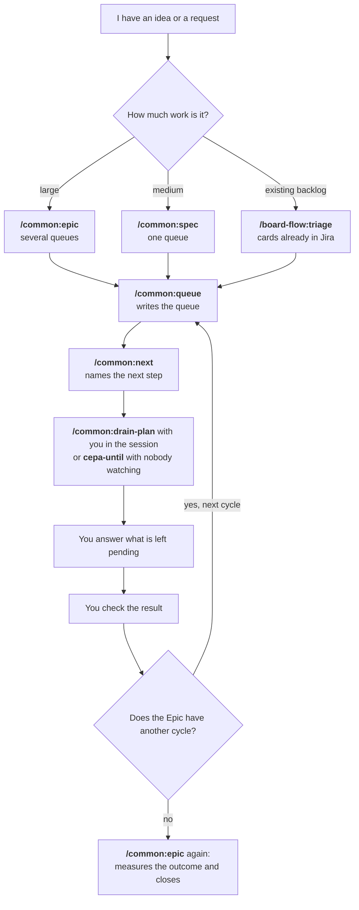

# The workflow, from idea to delivery

This page answers one question: **what do I do now, and what comes after that?** Each command has its details in another document, listed at the end. This page only gives the order.

## The whole picture

## Step 1: choose where to start

Epic and spec are **alternatives**, not consecutive steps. Each one writes a document, neither writes code, and both end in `/common:queue`.

| Your situation | Command | What it produces | How you know it worked |
|---|---|---|---|
| The work needs several queues and the order in which value appears matters | `/common:epic <name>` | `docs/epics/<name>.md`, with a ladder of cycles. A cycle is a slice someone can see working. | One script per cycle, with an effect on screen and in the backend |
| The work fits in one queue | `/common:spec "<idea>"` | `docs/spec/<slug>.md`, with success criteria | One test per criterion, which starts out failing |
| The requests are already Jira cards | `/board-flow:triage` | The classification of the cards and a proposed order | Each card has evidence in the code |
| The requests are in `BACKLOG.md` or in your head | Go straight to step 2 | | |
| The task is small and clear | `/build-team:plan-build-validate "<request>"`, or the equivalent for your topology (the team of agents installed in the repo) | Code and tests, with no queue needed | The build and tests pass |
| You do not know yet whether the problem exists | `/discovery:capture` | An opportunity to investigate | Evidence from users |

If you have no opinion between Epic and spec, ask: "does this fit in one batch of work?" If it does, use a spec.

Epic and spec run in a `discovery` mode session (`cepa --mode discovery`), where the agent can only write documents.

## Step 2: turn it into a queue

A **queue** is the ordered list of items to build, with the reason for each position. Only `/common:queue` writes it.

| It came from | Command |
|---|---|
| An Epic (one cycle at a time) | `/common:queue <name>-c1 --from-epic docs/epics/<name>.md --cycle 1` |
| A spec | `/common:queue <name> --from-spec docs/spec/<slug>.md` |
| A Jira triage | `/common:queue <name> --from-jira` |
| Your own list | `/common:queue <name>`, which asks for the items and the order |

For an Epic, name the queue `<name>-c<N>`. That name is how Cepa links the queue to the cycle and can tell where the Epic stands.

Before generating the queue from an Epic or a spec, settle the decisions the agent made alone during the interview: reopen the document and keep or veto each one. A veto does not undo code that was already built. The details are in [tres-portas.md](tres-portas.md).

## Step 3: build

`/common:next` names one next step and executes nothing. To execute, choose:

| You want to | Command | How it works |
|---|---|---|
| Stay with it | `/common:drain-plan <queue>` | Runs a few items in a row in the open session (`--max`, 3 by default) |
| Leave it running alone | `cepa-until <queue> --for 8h` or `--until 07:00`, in the terminal | Opens a new session for each item until the time runs out, and proves each change |
| Do one specific item | `/board-flow:execute <CARD>` | Runs one Jira card from start to finish |

If the repo uses Jira and work is left in the Review column, `/board-flow:prove <CARD>` proves one card and `/board-flow:prove-drain` proves the whole column. To prove means that a reviewer who did not write the code breaks each change on purpose and checks that some test fails.

## Step 4: answer what is left for you

| What happened | What to do |
|---|---|
| A `cepa-until` run ended | It asks in the terminal, one thing at a time, whether to land the branch (integrate what was done) and what is holding each item |
| You were not there to answer | `cepa-until decide <queue>/<run>` asks the questions again |
| Cards stayed in Review as `NEEDS-HUMAN` | `/board-flow:decide` turns them into yes/no questions |
| An autonomous run made decisions alone | `/common:debrief` shows each one for you to keep or change |

## Step 5: check and move on

**When the queue came from an Epic, run the cycle's script yourself.** Be careful: `cepa-plan epics`, which shows the state of the Epic, marks a cycle as closed (`fechado`) when every item of its queue has finished. It does not know whether anyone watched the demonstration. That check is yours.

After that:

- **There is another cycle:** go back to step 2 with `--cycle 2` and the queue `<name>-c2`.
- **It was the last cycle:** run `/common:epic <name>` again. It asks for the measured value of the outcome metric and changes the Epic to `Status: closed`.
- **The queue came from a spec:** it is finished when its items are.

To end the session at any point, use `/common:wrap-up`, which commits, writes the handoff (the note for the next session), merges the branch and pushes, behind one confirmation.

## When you get lost

| Question | Command |
|---|---|
| What do I do now? | `/common:next` |
| Where are we, in this session and in the Epic? | `/common:whereami` |
| What was asked and delivered so far? | `/common:recap` |
| What is in the whole queue? | `/common:queue-status` |
| Is the install healthy? | `/common:doctor` |

## A complete example

You want the billing operator to see contracts that are about to expire. It is several months of work.

1. `cepa --mode discovery`, then `/common:epic contract-alerts`. The interview produces three cycles.
2. `/common:queue contract-alerts-c1 --from-epic docs/epics/contract-alerts.md --cycle 1`.
3. Before you leave: `cepa-until contract-alerts-c1 --for 8h`.
4. When you come back, answer the questions in the terminal.
5. Open the screen and follow the script of cycle 1. Did it work? Repeat steps 2 to 5 with cycle 2.
6. After cycle 3, run `/common:epic contract-alerts` to record the measured outcome.

## Where to go deeper

| Subject | Document |
|---|---|
| Vocabulary and diagrams of the pieces | [how-it-fits.md](how-it-fits.md) |
| Session modes | [modos-de-trabalho.md](modos-de-trabalho.md) |
| What to do when a brief or an earlier spec already exists | [tres-portas.md](tres-portas.md) |
| The queue from the inside | [execution-plan.md](execution-plan.md) |
| Running with nobody watching | [cepa-until.md](cepa-until.md) |
| All commands | [commands.md](commands.md) |
